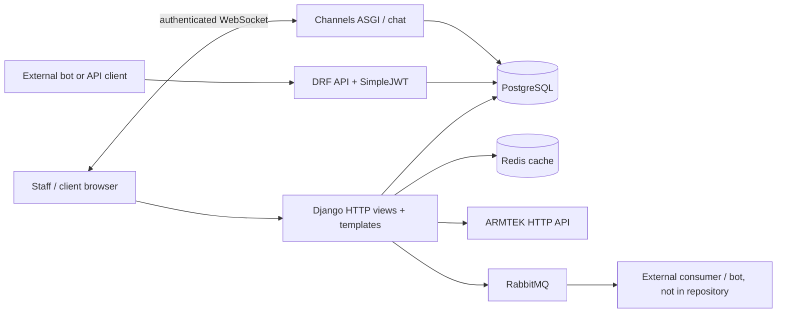
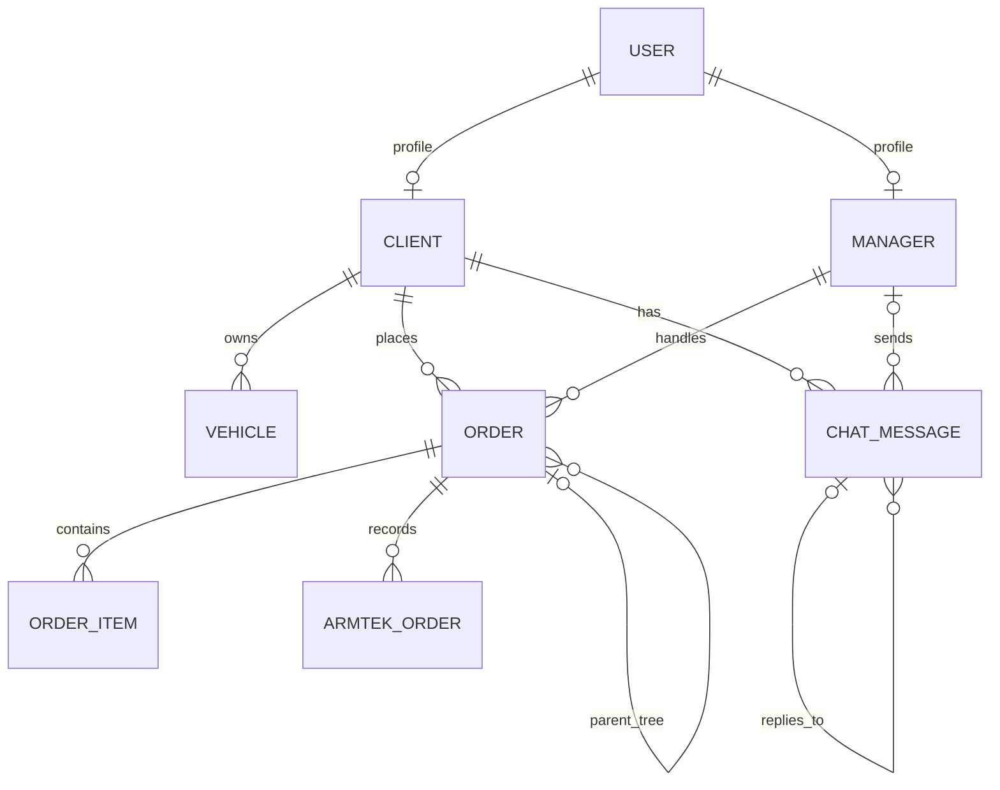

# Architecture

## Scope and evidence

This document describes the checked-in implementation. Repository facts are based on `auto_artel/`, `api/`, `orders/`, `chat/`, `home/`, `parts_providers/`, `content/`, `Dockerfile`, and `docker-entrypoint.sh`. A separate production topology, infrastructure-as-code, and external bot source are not present, so deployment and integration ownership beyond this repository remain unknown.

## Overview

Auto Artel is a Django application with two main interaction surfaces: server-rendered pages for staff and clients, and a JSON API intended for a bot/service account. PostgreSQL stores accounts, clients, vehicles, orders, line items, supplier-order responses, and chat messages. Order lifecycle updates can publish notifications through RabbitMQ. Supplier catalog searches and order submission call ARMTEK. Django cache is configured for Redis. The project also exposes a Channels WebSocket endpoint for staff chat.

The external RabbitMQ consumer and the bot that calls `/api/` are not implemented here. No scheduled-task framework or in-repository worker is present.

## Project map

| Path | Responsibility |
| --- | --- |
| `auto_artel/` | Django settings, HTTP/ASGI/WSGI entrypoints, root URL routing, broker and cache helpers |
| `home/` | Login, logout, landing page, setup management commands |
| `orders/` | Business models, staff order workflow, client approval links, supplier search/order UI, migrations |
| `api/` | DRF routes, API views, serializers and validators |
| `chat/` | Chat persistence, staff pages, WebSocket consumer and migrations |
| `parts_providers/` | Supplier interface and ARMTEK implementation / response schemas |
| `utils/` | Phone and date helpers |
| `content/templates/` | Shared Django template root |
| `content/assets/` | Shared CSS, images, JavaScript and vendored browser libraries |
| `Dockerfile`, `docker-entrypoint.sh` | Container build and startup procedure |
| `requirements.txt` | Python dependency pins / ranges |

## Request flow and applications

`auto_artel/urls.py` includes `home.urls` at `/`, `api.urls` at `/api/`, `orders.urls` at `/orders/`, and `chat.urls` at `/chat/`; Django admin is at `/admin/`. Staff order and chat views use Django templates. API calls pass through DRF and the project permission class `api.views.IsApiUser`, which requires authentication and membership in the `api` group. Django's session/authentication, CSRF, security, messages, common, and clickjacking middleware are enabled in `auto_artel/settings.py`.

For WebSockets, `auto_artel/asgi.py` routes HTTP to Django and WebSockets through `AuthMiddlewareStack` to `auto_artel/websocket_urls.py`; the only configured socket route is `/ws/chat/`. There is no configured `/ws/orders/` route even though `orders/templates/orders/base.html` contains a dormant notification client. `auto_artel/develop.py` and `auto_artel/test.py` configure an in-memory Channels layer; no shared production channel layer is documented or configured in the checked-in deployment files.

## Data model

`orders/models.py` is the domain center. Django's built-in `User` is linked one-to-one to `Client` or `Manager`. A client owns vehicles and orders. Orders contain order items and can form a parent/child tree (`parent`, `root_id`, `h_id`, `child_next_id`). An order can retain one or more `ArmTekOrder` records with provider response JSON. `chat/models.py` stores `ChatMessage`, linked to a client, optionally a manager, and optionally another message as its reply target. `api/models.py` has no domain models.

Foreign-key deletion policies vary by domain: order items and additional child orders cascade with their parent; client/manager references on orders are protected; vehicle/client and chat relationships restrict deletion. Database history is in per-app migration directories (`orders/migrations/`, `chat/migrations/`); home and API have migration packages but no migration files listed. PostgreSQL is required by the configured backend and by `ChatMessage.media`'s PostgreSQL `ArrayField`.

## Authentication and authorization

Browser login is implemented by `home/views.py` and `home/forms.py`; staff page access is generally guarded with `ManagerMixin` / `IsManagerMixin` group checks. The login form also requires the user permission `sessions.add_session`; `home/management/commands/init.py` grants that permission to the manager group. DRF uses SimpleJWT authentication globally and the API views require the `api` group. The API group/user is created by the `init` command. Client approval links in `orders/urls_helper.py` are signed, expire, include client/order claims, and use a dedicated `ORDER_LINK_SECRET_KEY` separate from API JWT signing.

Authorization is not uniformly object-scoped: inspect each API view and WebSocket action before extending it. See the [security review notes](#security-review-notes).

## Data and integration flows

- The staff order workflow searches ARMTEK through `parts_providers/armtek.py`, saves order/item state in PostgreSQL, and submits provider orders through the same adapter.
- `orders/signals.py` publishes a client-status notification after transaction commit through `auto_artel/broker.py`. Order approval/invoice paths also publish action-required notifications. Broker queues are `chat_messages` and `automatic_notifications`.
- The API accepts client, vehicle, order and chat operations through `api/views.py` and serializers. API routes are listed in `api/urls.py`.
- Staff chat pages query `ChatMessage`; the socket consumer writes/edits messages and can forward messages to RabbitMQ.

ARMTEK credentials are read from `ARMTEK_LOGIN` and `ARMTEK_PASSWORD`. Database, cache, broker, base URL, signing key, and bot-user credentials are read from environment variables (variable names are listed in [BACKEND.md](BACKEND.md)). No credential values are documented.

## Configuration and deployment

`auto_artel/settings.py` is the base configuration and loads `.env` with `python-dotenv`. `auto_artel/develop.py` enables `DEBUG`, restricts hosts to localhost, configures file logging and an in-memory channel layer. `auto_artel/test.py` sets `DEBUG=False`, derives host/CSRF/CORS origins from `ALLOWED_HOST`, and configures file logging and an in-memory channel layer. The file name `test.py` does not establish a production environment; how it is used is unknown.

`Dockerfile` uses Python 3.12 slim, installs `requirements.txt`, creates a non-root `django` user, exposes port 8888, and launches `docker-entrypoint.sh`. That entrypoint waits for PostgreSQL, runs `collectstatic`, runs `migrate`, invokes `init` and `createadmin`, and starts Daphne on `0.0.0.0:8888`. There is no compose, proxy, orchestration, TLS termination, or health-check configuration in the repository. The container entrypoint's automatic migrations and account initialization should be considered in release operations.

## Architecture constraints and risks

- Most business rules reside in the large `orders/views.py`, with pricing/status logic on models and notification side effects in a signal. This couples HTTP workflow, persistence, and integration behavior.
- `AUTO_PARTS_PROVIDERS` is a settings-level registry, but only ARMTEK is configured and implemented as a concrete provider.
- Redis is configured as Django's default cache, while Channels uses an in-memory layer in both included environment-specific settings files.
- No production deployment topology, queue consumer, external bot implementation, API schema, or operational runbook is present; these are unknown.
- Detailed security findings and investigation targets are listed below and in [BACKEND.md](BACKEND.md).

## Security review notes

Confirmed implementation observations (not a penetration test):

1. `parts_providers/armtek.py` uses `http://ws.armtek.ru/...` URLs while attaching HTTP Basic credentials via `requests.Session.auth`. The credentials and provider traffic are not protected by TLS at the application URL layer.
2. `chat/consumers.py` checks only that a WebSocket user is authenticated. It accepts client/message identifiers from events; `mark_messages_read` updates all unread messages for the supplied client, and edit lookup does not verify message ownership. Any authenticated user can reach these actions unless access is constrained elsewhere (no such socket authorization is visible in this repository).
3. `api/views.py` prints the full vehicle registration request body. `orders/views.py` has broad exception handlers that return exception text in JSON responses in some workflows. Review for PII leakage and internal error disclosure.
4. `home/forms.py` performs a username lookup and password check directly instead of using Django's `authenticate()` flow. It should be reviewed for authentication backend, throttling, and timing behavior; no login throttling is configured in the inspected source.
5. Base security settings do not explicitly configure secure session/CSRF cookies, HSTS, or proxy/TLS behavior. Whether a trusted reverse proxy provides these controls is unknown. `auto_artel/test.py` sets CORS-related settings, but no CORS middleware/package appears in `requirements.txt` or `INSTALLED_APPS`; effective CORS behavior needs verification.
6. `api.views.ClientView` serializes all matching clients when filters are absent, and API access is group-wide rather than scoped to an individual client. Confirm that this breadth matches the bot trust boundary.
7. `docker-entrypoint.sh` creates an admin with a fixed username/email (the password is environment-supplied through Django's management command convention) and performs migrations at startup. Confirm that production deployment controls and idempotency expectations are appropriate.

The order approval link is an explicit bearer credential. Its expiry/signature and isolated signing key are implemented, but URL/referrer/log exposure and client-side handling should still be considered during review.
